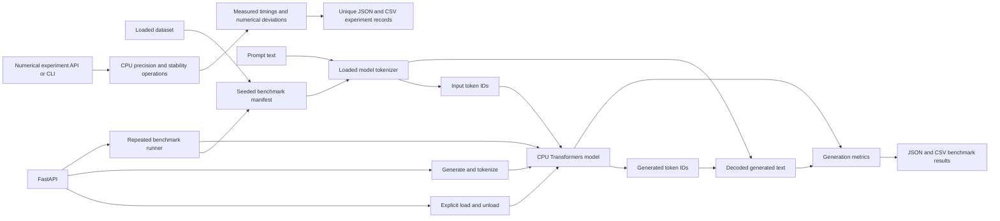

# Architecture

The application keeps optional ML runtime imports and model loading out of
startup. The Transformers adapter imports PyTorch and Transformers only when
the corresponding backend operation is requested; weights are loaded only by
an explicit load request.

## Inference flow

1. A caller explicitly loads one model ID. The backend loads its matching
   tokenizer and causal language model from the configured Hugging Face cache;
   network access is disabled unless explicitly enabled.
2. The model is moved to `torch.device("cpu")` and put in evaluation mode.
   Generation runs within `torch.inference_mode()`. No CUDA/ROCm setup or GPU
   acceleration is attempted.
3. The actual model tokenizer encodes the prompt into IDs. The model
   autoregressively predicts output token IDs, which that tokenizer decodes
   into text.
4. `time.perf_counter()` measures tokenizer time, model-load time, and
   generation time separately. Generation tokens per second is output-token
   count divided by `model.generate()` duration.
5. TTFT is unavailable because the current `generate()` call path does not
   observe the first emitted token. It is returned as `null`, never estimated.
6. If `psutil` is installed, RSS and process CPU are sampled during generation.
   RSS is whole-process memory, not model-only or incremental memory.

## Benchmark flow

`InferenceBenchmarkRunner` uses the Phase 3 dataset registry and seeded
benchmark input preparation. The selected sample IDs and actual-tokenizer input
counts are recorded. Warm-up passes execute before measured repetitions and
are excluded from result statistics. Each run records configuration,
environment and model revision metadata, per-request measurements, and
non-overwriting JSON and CSV files under the configured benchmark output
directory.

The benchmark API requires both the requested dataset and model to be loaded.
The CLI benchmark script loads them explicitly. Neither application startup nor
dataset discovery triggers a model download.

## API surfaces

- `GET /inference/backends`: backend availability and capabilities
- `GET /inference/status`: configured, cached, loaded, and ready model state
- `POST /inference/load` and `/inference/unload`: explicit lifecycle
- `POST /inference/generate`: CPU generation and metrics
- `POST /inference/tokenize`: encode with the loaded model tokenizer
- `POST /benchmarks/run` and `GET /benchmarks/results`: run and list results

Existing dataset, tokenization, health, and system routes remain available.

## Numerical experiment flow

`app.numerical_lab` imports PyTorch lazily when a caller runs an experiment.
Operations explicitly use CPU tensors and verify each dtype/operator directly.
Float32, float64, float16, and bfloat16 operations are reported as measured,
unsupported with the runtime reason, or failed; no dtype is silently
substituted. Matrix inputs are deterministic and bounded to square sizes up to
512. Timing includes configured warm-ups followed by measured iterations;
percentile 95 latency is omitted below 20 measured samples.

The runner records seed, dimensions, dtype, environment, timings, error metrics,
and per-operation status, then writes a UUID-named JSON and CSV pair beneath
`benchmarks/results/numerical/`. It uses exclusive file creation and does not
overwrite existing results. The experiment API exposes discovery, execution,
bounded summary listing, and UUID-only complete-result retrieval; it does not
accept arbitrary paths from callers.

The stability experiment records observable accumulation/cancellation, safe
float16 overflow/underflow examples, and naive versus stabilized softmax. The
reproducibility experiment verifies same-seed tensor equality and repeated CPU
matrix multiplication on the current runtime only; it does not promise
cross-platform bitwise reproducibility.

## Real measurements versus mocked tests

Unit and API tests inject small deterministic model/tokenizer doubles. They
verify device selection, lifecycle, generation arguments, validation, metric
shapes, and persistence without downloading weights. Their durations and
outputs are not model performance results.

Real measurements exist only when a caller loads actual model weights and runs
inference or the benchmark CLI/API. The test suite does not download the
educational `sshleifer/tiny-gpt2` weights and does not report fabricated
performance values.
