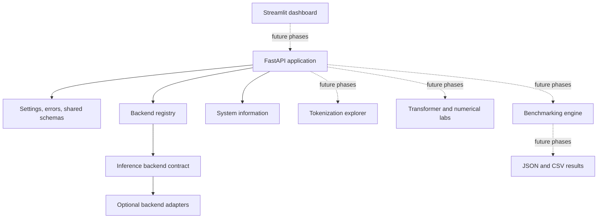

# Architecture

The project is organized around a small CPU-first core. Optional frameworks
remain isolated from API startup so that importing the application does not
require model weights or ML runtime packages.

## Current boundaries

- `app.core` owns environment-backed settings, logging, API-safe exceptions,
  and validated request/result schemas.
- `app.inference.base` defines the contract for backend adapters.
- `app.inference.registry` checks each registered adapter's optional import
  requirements before asking it to report runtime and hardware availability.
- `app.main` creates the FastAPI application and exposes health, backend
  discovery, and basic system information.
- Tokenization, educational transformer code, model adapters, numerical
  experiments, benchmarking, and the dashboard are future-phase modules.

No concrete inference adapter is registered in this phase. Therefore
`GET /backends` returns an empty list until an adapter is implemented and
registered. This avoids treating an installed package as proof that a model
can run on the current hardware.
